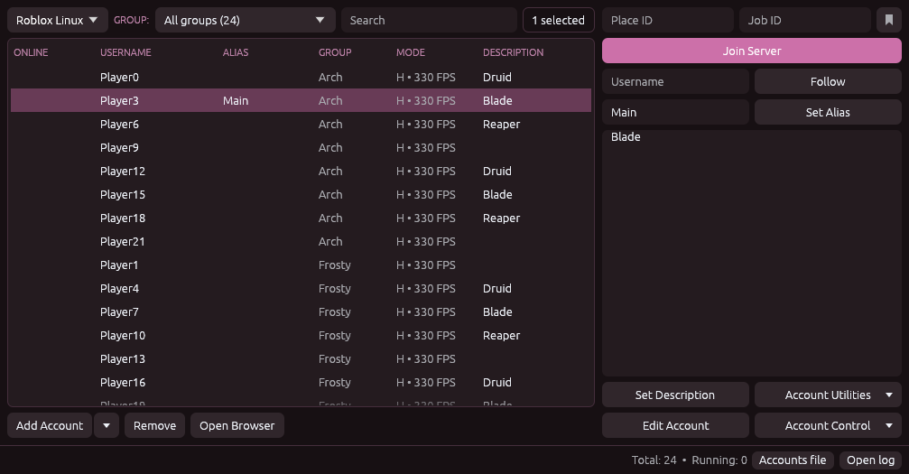

# Alyae

An account manager for Roblox and other games, on Linux and Windows. It keeps your accounts'
cookies, passwords and 2FA secrets encrypted, and starts several Roblox accounts at once. On Linux
each account runs in its own [Mocktail](https://github.com/komaruworld/mocktail).



## Windows

Download [Alyae-portable.zip](https://github.com/vysaely/alyae/releases/tag/portable), unzip it
anywhere and run `alyae.exe`. Your accounts are kept in the `data` folder next to it.

You need the Roblox app installed. Windows may say the publisher is unknown: click
More info, then Run anyway.

## Linux

Install the dependencies (Arch):

```bash
sudo pacman -S --needed rust webkit2gtk-4.1 base-devel git cmake ninja pkgconf lld sdl3 sdl3_ttf \
    curl openssl nlohmann-json libyaml libelf minizip capstone gtk4 libadwaita webkitgtk-6.0 \
    libutf8proc fontconfig libglvnd libplacebo vulkan-headers vulkan-icd-loader zlib
```

On other distros, install Rust, webkit2gtk-4.1 and the packages from Mocktail's
[Build from source](https://github.com/komaruworld/mocktail#build-from-source) section.

Then:

```bash
git clone https://github.com/vysaely/alyae.git
cd alyae
./install.sh
modules/roblox-linux/mocktail/build.sh
```

`build.sh` builds Mocktail with Alyae's patches. If AEAM already installed Mocktail you can skip
it, but anti-AFK only works with this build. To update, run `git pull` and both scripts again.

To uninstall, run `./install.sh --uninstall`. Your accounts in `~/.local/share/alyae` are kept.

## Moving your accounts

**Accounts file** (bottom right) saves every account into one file locked with a password. Open it
on another PC with Add Account → From an accounts file.

The same dialog also reads Roblox Account Manager's `AccountData.json` and AEAM's data folder.

## License

[GPL-3.0](LICENSE). The patches in `modules/roblox-linux/mocktail/` change Mocktail, which is
Apache-2.0, and are Apache-2.0 as well.
